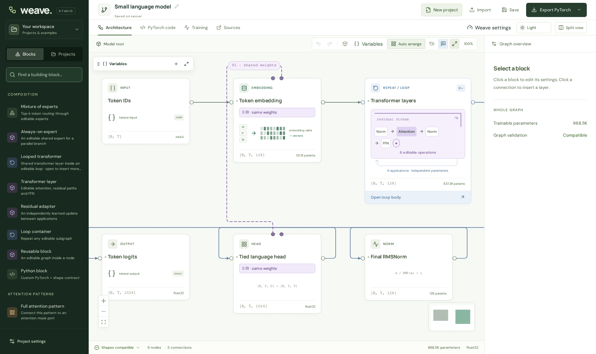
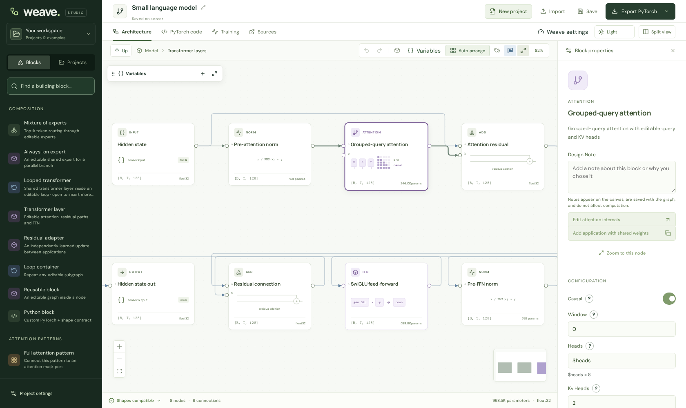

# Weave

Design neural networks in your browser, inspect their tensor shapes, and export them as readable PyTorch code.



Build a model from layers, open a transformer to edit its internals, or study a reference beside your own graph. Loops, attention, n-gram memory and mixtures of experts can be combined on the same canvas.

- **Edit the computation.** Nest blocks, insert layers, share weights, and bind settings to graph variables.
- **Check the design.** See tensor shapes, parameter counts, connection errors and advisory design notes.
- **Export Python.** Generated models use ordinary PyTorch modules and loops, with helper files for specialized operations.
- **Train and test.** Edit Python training scripts, launch stages, monitor loss and hardware, and try checkpoints with chat or text completion. Tool-call testing supports optional local decoders.

## Get started

On **Linux or WSL2**, install [uv](https://docs.astral.sh/uv/getting-started/installation/), **Node.js 20.19+**, and npm. The installer downloads Python 3.12, builds the UI, and prepares a separate CPU training environment.

```bash
git clone https://github.com/mistrjirka/Weave.git
cd Weave
bash scripts/install.sh
bash scripts/start.sh
```

Open **http://localhost:8173**. Choose **New project** to start from a blank graph or copy a reference model.

For editor/export only, install with `bash scripts/install.sh --training none`. For GPU training, select a compatible existing PyTorch environment with `--training-python /path/to/venv/bin/python`. See [installation and updates](INSTALL.md).

Prefer a container? [Docker setup](DOCKER.md) covers persistent storage and optional CPU/NVIDIA training.

**Weave runs Python with the server user's permissions.** Use it on a trusted machine or network. The native launcher listens on `0.0.0.0:8173`; Docker binds to localhost by default.

## Explore a model

Examples include decoder and looped transformers, text diffusion, MoE, embedding tables, GPT-2, Needle 1–3, Thimble, Hammer 2.1 and LFM2.5 SHELLper. They describe model computation and start with random weights. Reference-specific omissions and fidelity checks are documented in the [user guide](USER_GUIDE.md#reference-projects-and-fidelity) and [architecture audit](ARCHITECTURE_AUDIT.md).

<details>
<summary>Inside a transformer</summary>



</details>

Training requires your own data loader and data. Exporting a graph does not produce a pretrained model.

## Documentation

| I want to… | Guide |
| --- | --- |
| Install, configure paths, use a GPU, or start after reboot | [Installation](INSTALL.md) · [Docker](DOCKER.md) |
| Edit graphs, tokenizers, shared weights and reference models | [Using Weave](USER_GUIDE.md) |
| Write a training script, cache data or add augmentations | [Training authoring](TRAINING_GUIDE.md) |
| Launch, monitor, resume and back up training runs | [Training operations](TRAINING.md) |
| Test tool calls with a constrained decoder | [Checkpoint chat](CHECKPOINT_CHAT_DECODERS.md) |
| Control Weave from an MCP client | [MCP](MCP.md) |

For development and checks, see [CONTRIBUTING.md](CONTRIBUTING.md). Report bugs through [GitHub issues](https://github.com/mistrjirka/Weave/issues), with reproduction steps and the relevant graph or error output.

[MIT license](LICENSE). Architecture sources, libraries and fonts retain their [upstream licenses and attribution](THIRD_PARTY_NOTICES.md).
